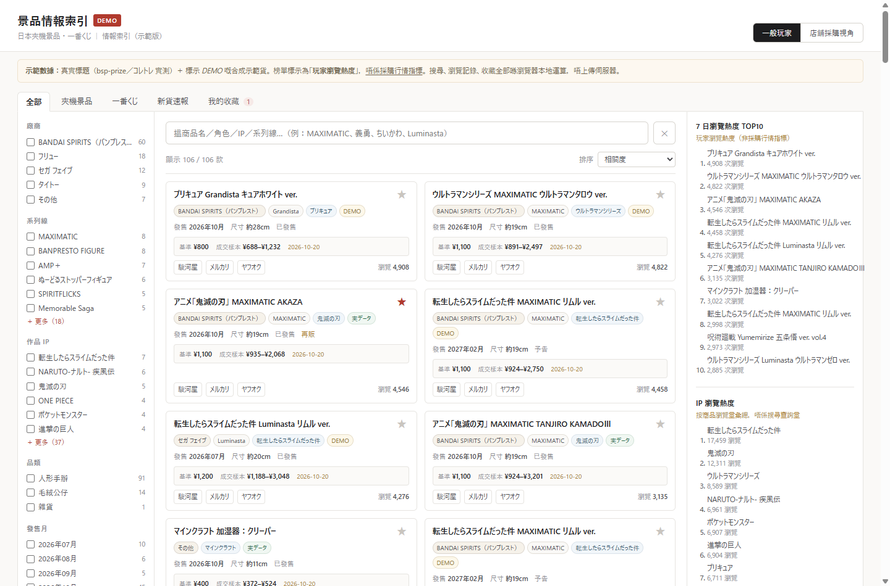
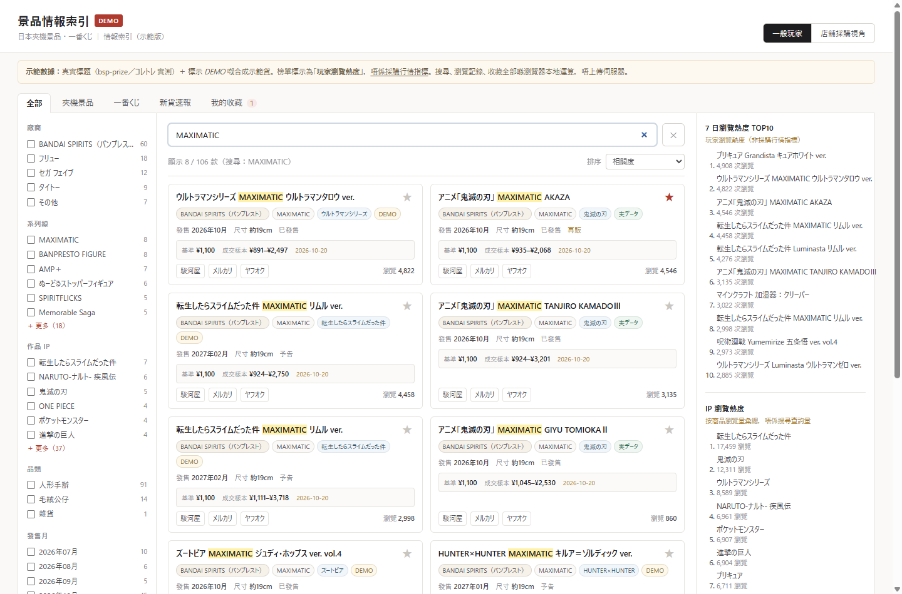
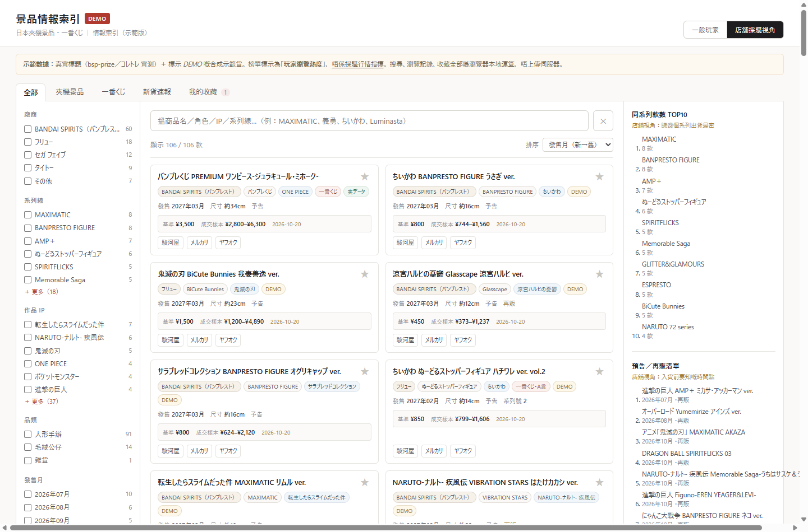
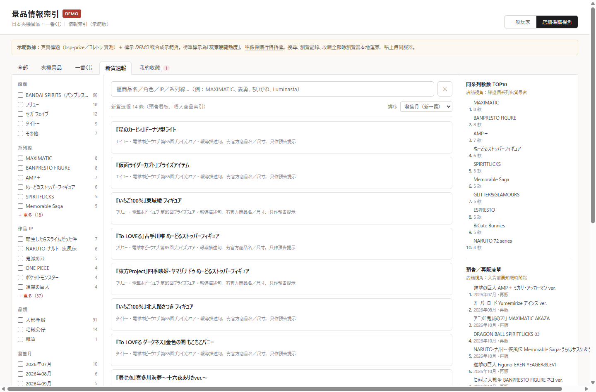

# 前端 MVP 靜態 Demo — 說明

> 目標：**唔需要 PostgreSQL、唔需要後端**，即刻可瀏覽，用嚟驗搜尋／篩選／榜單／收藏嘅實際體驗同流量潛力。
> 數據來源：`taxonomy.json`（由 `module1/aliases.py` 導出）＋ `data/items.json`（示範索引，由 `build_demo.py` 生成）

---

## 一秒打開

| 方式 | 做法 | 備註 |
|---|---|---|
| **最快** | 雙擊 `standalone.html` | 所有 CSS/JS/JSON 已內聯，`file://` 直接開得，**唔使 server** |
| 標準 | `pwsh -File serve.ps1` → http://127.0.0.1:8765/ | 用 `index.html` + `data/*.json`，行為同正式站一致 |

> 直接用 `file://` 開 `index.html` 會因為 `fetch()` 被瀏覽器封鎖而載入失敗——所以先有 standalone 版。

---

## 畫面

| 一般玩家視角（7 日瀏覽熱度 + IP 熱度） | 搜尋高亮（MAXIMATIC） |
|---|---|
|  |  |

| 店舖採購視角（系列款數 + 預告／再販） | 新貨速報（預告看板） |
|---|---|
|  |  |

---

## 部署上 Cloudflare Pages

### 已準備好嘅上傳包：`dist/`

| 檔案 | 作用 |
|---|---|
| `dist/index.html` | standalone 全內聯版（176KB，單檔零依賴） |
| `dist/robots.txt` | Beta 期間 `Disallow: /`（避免示範數據被搜尋引擎當真） |
| `dist/_headers` | Cloudflare Pages 專用：`X-Frame-Options`、`nosniff`、`Referrer-Policy`、**CSP `default-src 'none'`** |

> CSP 寫成 `default-src 'none'` 係刻意嘅：連 `connect-src` 都封死，
> 即係就算日後有人偷加追蹤 script，都**送唔出任何數據**。呢個係「零收集」嘅第二重保證。

### 一鍵部署（要喺有網絡嘅機跑）

```powershell
# 首次（只需一次）
npx --yes wrangler login
npx --yes wrangler pages project create prize-intel-beta --production-branch main

# 之後每次更新
python prize-intel\web\demo\build_demo.py   # 重生 dist/
pwsh -File prize-intel\web\demo\deploy.ps1  # 上傳
```

完成後 URL 通常係 `https://prize-intel-beta.pages.dev`。
回滾：Cloudflare Dashboard → Pages → Deployments → 揀舊版本 → Rollback。

### 部署後必做檢查（2 分鐘）

1. 開 incognito 視窗，開 URL → 見到 `DEMO` `BETA` 兩個標籤。
2. 捲到底 → 見到完整 6 條免責聲明。
3. DevTools → Network → 重新載入 → **應該只有 1 個 document 請求**（連 favicon 都冇）。
4. `view-source:` 搜 `gtag` / `plausible` / `fetch(` → 應該全部 0 命中。

---

## 意見・要望・苦情（mailto，零後端）

側欄同頁底各有「意見・要望・苦情はこちら」入口：撳一下直接開你嘅郵件程式，**唔使註冊、唔使填表**。
旁邊「一鍵複製郵件模板」會複製：

```
[景品情報索引 Beta v0.2] 意見・要望・苦情
版本：v0.2
視角：一般玩家
最近搜尋：…
當時篩選：…
我想反映：① 缺邊個 IP／系列 ② 搵唔到邊件貨 ③ 其他
```

設定聯絡郵箱（唯一一個位）：

```json
// web/demo/config.json
{ "beta_version": "v0.2", "contact_email": "you@example.com" }
```

改完 re-build，dist 同 standalone 會自動同步。**未設定時**：撳 CTA 只會複製模板並提示，
唔會開空白郵件；build 亦會出警告。

冇追蹤、冇 cookie、冇工單系統——你只會收到對方自願寄出嘅郵件，唔會知邊個訪問過。

---

## 真數據版本（模塊 #4 已接）

```powershell
# 1) 由真 NamingResult / HTML corpus 生成正式 items.json
python prize-intel\pipeline\export_items.py
#    可選：--corpus <HTML 快取目錄>   --jsonl <module3 dump>
# 2) 用真數據打包前端（同一份前端，零改動）
python prize-intel\web\demo\build_demo.py --items prize-intel\web\demo\data\items.real.json
```

真數據版 `_meta` 會標 `views_available=false` / `price_available=false`，價格顯示 `—`、
榜單標「熱度數據未接」——**刻意唔造假數**，等 `item_view_daily` / `price_ref` 接上。

---

## Beta 用戶測試

流程、訪談問題、記錄表喺 [beta/回饋收集指引.md](../../beta/回饋收集指引.md) 同 [beta/回饋記錄表.csv](../../beta/回饋記錄表.csv)。

頁面側欄有個「**複製我嘅搜尋記錄**」按鈕：只會把最近搜尋詞＋篩選狀態變成文字放去剪貼板，
**由測試者自己決定貼唔貼返你**，冇任何自動上傳。

---

## MVP 有咩功能

| 功能 | 實作 |
|---|---|
| 搜尋 | 商品名／角色／IP／系列線／廠商，全部前端本地過濾；支援全形／片假名／大小寫正規化 |
| 多維篩選 | 廠商・系列線・IP・品類・發售月・尺寸（5cm 桶）・狀態；每項顯示數量，可「更多」 |
| 主分類 tab | 全部 / 夾機景品 / 一番くじ / 新貨速報 / 我的收藏 |
| 7 日熱門榜 | 標題明確寫「**玩家瀏覽熱度（非採購行情指標）**」 |
| IP 榜 | 標題寫「按商品瀏覽量彙總，唔係搜尋查詢量」 |
| 視角切換 | 一般玩家 ↔ 店舖採購視角；**純前端**，狀態存 `localStorage` |
| 本地收藏 | ★ 一鍵收藏，存 `localStorage` |
| 最近搜尋 | 只存 `localStorage` |
| 新貨速報 | 電撃PF 報導行，標明「預告看板，唔入商品索引」 |

### 兩個視角嘅分別（同一套數據，唔同重點）

| | 一般玩家 | 店舖採購視角 |
|---|---|---|
| 預設排序 | 相關度 | 發售月（新→舊） |
| 卡片 | 顯示瀏覽熱度 | 顯示系列號，隱藏瀏覽熱度 |
| 右側榜 1 | 7 日瀏覽熱度 TOP10 | 同系列款數 TOP10 |
| 右側榜 2 | IP 瀏覽熱度 | 預告／再販清單 |

---

## 私隱（同 schema 設計一致）

- 搜尋、篩選、排序**全部喺記憶體完成**，冇任何 query 送上伺服器（靜態站根本冇接收端）。
- 收藏／瀏覽記錄／最近搜尋／視角偏好只寫 `localStorage`（key 前綴 `pi.`）。
- 側欄有「清除本地資料」按鈕。
- 冇 cookie、冇 analytics、冇 user id。

---

## 數據誠實聲明

- **真實標題**（`is_real: true`，UI 顯示「実データ」）：來自 2026-10-28 實測嘅 bsp-prize item 頁同コレトレ 文章頁。
- **合成示範貨**（`demo: true`，UI 顯示「DEMO」）：用真實 IP／角色／系列線組合生成，只為令篩選同榜單有足夠樣本。**唔係真實商品**。
- 瀏覽數、價格全部係示範值（deterministic 生成），唔代表真實行情。
- 電撃PF 14 條只入「新貨速報」看板，**冇入商品索引**——對應模塊 #2 政策（冇官方商品名嘅資料唔准入 item 比對）。

---

## 檔案

```
web/demo/
├─ index.html        頁面骨架（讀 data/*.json）
├─ app.js            全部邏輯（~430 行，零依賴）
├─ styles.css        日系簡潔風（白底／細線／低飽和）
├─ data/
│  ├─ taxonomy.json  分類樹（由 module1/aliases.py 導出，**唔准手改**）
│  └─ items.json     示範商品索引 + 速報看板數據
├─ standalone.html   全內聯版（雙擊即開）
├─ build_demo.py     生成 items.json + standalone.html
└─ serve.ps1         靜態 server（可選）
```

## 重新生成

```powershell
# 1) 改完 aliases.py 之後，先重生 taxonomy
python prize-intel\module1\export_taxonomy.py
# 2) 重生 demo 數據 + standalone
python prize-intel\web\demo\build_demo.py
```

`taxonomy.json` 一變，篩選欄嘅廠商／IP／系列線／品類／賞級會自動跟住變——前端冇 hardcode 任何分類名。

---

## 刻意未做（按你嘅範圍）

- ❌ L2 指紋合併、角色抽取、一番賞賞品深度解析（等 DB 就緒）
- ❌ 討論板、避坑板、行情走勢圖、港元價格
- ❌ 真實爬蟲數據（等模塊 #3 接上真來源）
- ❌ 圖片（版權；用文字卡代替）

## 下一步可以點驗

1. 用 `standalone.html` 傳俾幾個場主／朋友，睇佢哋搵唔搵到想搵嘅嘢（記低搜尋詞）。
2. 如果要做真流量測試：將 `demo/` 放上任何靜態托管（GitHub Pages／Cloudflare Pages／Netlify），**唔需要 server code**。
3. 收集到搜尋詞之後 → 反推要補邊啲別名（改 `aliases.py`，重生 taxonomy，前端即刻同步）。
